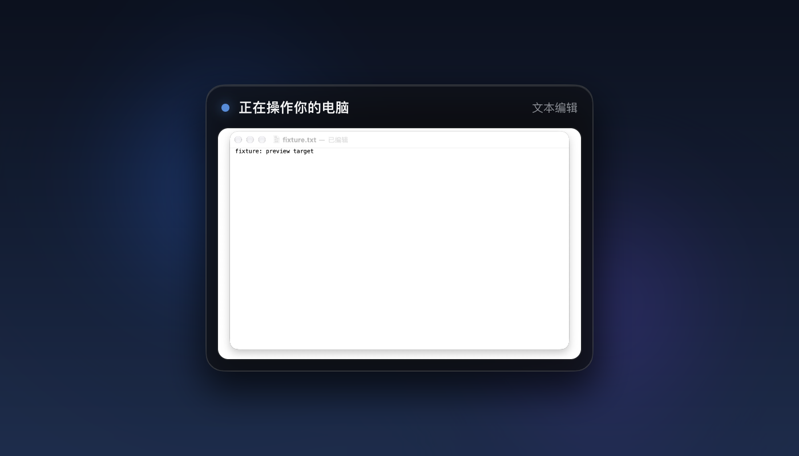

<p align="center">
  
</p>

<h1 align="center">dsh-cua-preview</h1>

<p align="center">
  Codex 风格的 <b>DeepSeek Harness 后台电脑操作小窗预览</b>（macOS）<br />
  A Codex-like floating glass preview window for DeepSeek Harness background computer-use.
</p>

<p align="center">
  <a href="LICENSE"></a>
  
  
</p>

> 当 DeepSeek Harness 的 Agent 在**后台**操作某个 macOS 窗口时，屏幕角落会出现一个 Codex 风格的毛玻璃小窗，**只显示被操作的那个窗口**的实时缩略画面与当前动作。它不抢前台、不移动鼠标、不显示整个桌面，也不会把其他 app 的画面带进预览。

## 目录

- [它解决什么问题](#它解决什么问题)
- [特性](#特性)
- [效果](#效果)
- [工作原理](#工作原理)
- [环境要求](#环境要求)
- [安装](#安装)
- [使用](#使用)
- [配置](#配置)
- [隐私与安全](#隐私与安全)
- [已知限制](#已知限制)
- [卸载](#卸载)
- [故障排查](#故障排查)
- [开发](#开发)
- [English summary](#english-summary)
- [许可证与致谢](#许可证与致谢)

## 它解决什么问题

当 Agent 使用后台 Computer Use 操作软件时，用户通常只能看到前台应用，不知道 Agent 此刻在操作哪个窗口、点了哪里。Codex 的 Computer Use 会显示一个小预览窗；本项目把同样的体验带进 DeepSeek Harness：

- **只显示被操作的窗口**，而不是整个屏幕；
- 小窗**永远不会抢走前台窗口和键盘焦点**；
- 用户可以**用鼠标拖动，或用 macOS 三指拖移**把小窗放到任何位置，位置会被记住；
- Agent 空闲后自动隐藏，下次操作自动出现。

本项目只做“预览/观察”，**不发送任何鼠标或键盘事件**——真正的输入仍由 Computer Use 提供器（[Anionex 的 `@anionex/dsh-computer-use`](https://github.com/Anionex/dsh-computer-use)）以不抢焦点的方式完成。

## 特性

- 🖼 **窗口级绑定**：预览的唯一数据来源是 `screencapture -l<windowId>`，窗口 id 来自 Computer Use 的 observation JSON；没有有效窗口就不显示，绝不退化成全屏预览。
- 🪟 **Codex 式玻璃拟态**：macOS 原生 `vibrancy: 'hud'` 材质 + 58% 深色 tint、圆角、细高光描边和柔和投影。
- ⚡ **尽量流畅**：覆盖层以约 140ms 间隔自采集目标窗口（通常 3–7 fps），双缓冲交叉淡入消除闪烁。
- 🖱 **可拖动 + 位置记忆**：整张卡片是拖动区，支持鼠标拖动与 macOS「三指拖移」；位置保存在 `~/.dsh/cua-preview/window-state.json`。
- 👻 **不抢焦点**：`focusable: false` + `showInactive()` + `type: panel`；不接收键盘输入。
- 🔒 **本地且最小权限**：抓屏在 DSH Host 派生的进程链内执行，复用 Host 已有的「屏幕录制」授权，不新增 TCC 授权；帧只在 `/tmp` 短暂落盘后立即删除；循环回环 socket 带随机 token；不访问网络、无遥测。
- ⏱ **自动出现/隐藏**：Agent 有 Computer Use 活动时显示，闲置 `activeMs`（默认 12s）后自动隐藏。

## 效果

<p align="center">
  
</p>

图中预览只包含 TextEdit 的目标窗口（桌面上还有其它应用的窗口，但不会出现在小窗里）。

## 工作原理

```
DeepSeek Harness Host（已有 Screen Recording 权限）
└─ dsh-cua-preview 插件（plugin/index.js）
     ├─ 监听 session/event 里的 computer_* tool/call 与 tool/result
     ├─ 从 tool result 的 observation JSON 取出精确的 app + window.id
     ├─ 启动一个独立 Electron 覆盖层（app/），通过 127.0.0.1 + 随机 token 通信
     └─ 发送 target { windowId, app, title, status } / activity / hide
          │
          ▼
Electron 覆盖层（app/main.js，非激活置顶面板）
     ├─ 只对 target.windowId 执行 `screencapture -x -t jpg -l<windowId>`
     ├─ 3–7 fps 抓帧，双缓冲交叉淡入显示
     ├─ 标题「正在操作你的电脑」+ 应用名 + 瞬时动作 caption
     └─ 12s 无活动自动隐藏；用户可拖动，位置持久化
```

设计取舍与协议细节见 [docs/ARCHITECTURE.md](docs/ARCHITECTURE.md)。

## 环境要求

| 项 | 要求 |
|---|---|
| 操作系统 | macOS 14 或更新（开发/实测：macOS 27） |
| DeepSeek Harness | **Desktop 版 0.2.1-rc.2**（`dsh.compatibility.dsh = >=0.2.1-rc.2 <0.3.0-0`） |
| Computer Use 提供器 | 已安装并启用 [`@anionex/dsh-computer-use`](https://github.com/Anionex/dsh-computer-use) v0.3.x；本项目只预览它的 `computer_*` 工具 |
| Electron | 任意官方 Electron 二进制。推荐直接复用 dsh-orb 已缓存的 `~/.dsh/dsh-orb/electron-runtime/Electron.app`，或把 `electronPath` 指向 `/Applications/Electron.app` |
| 屏幕录制权限 | DSH 已获得（Computer Use 本身就需要）；本项目不额外申请 |
| Node.js | **不需要**单独安装：安装脚本使用 DSH 自带的 pnpm 与 Electron 的 Node 模式 |

## 安装

> ⚠️ DSH 桌面版的 `desktop` profile 由 Electron 应用独占管理，官方 `dsh plugin --profile desktop` 会拒绝操作。下面的脚本按与 Plugins 页相同的两步执行（`pnpm add file:` + 写入 `cordis.patch.yml`），并在改动前自动备份。

### 方式 A：一键脚本（推荐）

```bash
git clone https://github.com/ZhaoGC4/dsh-cua-preview.git
cd dsh-cua-preview
bash scripts/install.sh
```

脚本会：

1. 备份 `~/.dsh/profiles/desktop/{package.json,cordis.patch.yml,pnpm-lock.yaml}` 到 `~/.dsh/cua-preview/install-backup-<时间戳>/`；
2. 用 DSH 自带运行时 pnpm 把本仓库以 `file:` 依赖安装进 desktop profile；
3. 在 `cordis.patch.yml` 追加带标记的插件行（含 `electronPath`）。

然后**重启 DeepSeek Harness**（保存好正在进行的工作；插件重载/宿主重启会中断当前会话）。

> 如果装过 dsh-orb，脚本会自动复用它的 Electron 缓存；否则请先安装 Electron 或设置 `DSH_CUA_PREVIEW_ELECTRON=/path/to/Electron`。

### 方式 B：手动安装

```bash
# 1) 记下仓库绝对路径
REPO="$(pwd)"
DSH_APP="/Applications/DeepSeek Harness.app"
RT="$DSH_APP/Contents/Resources/runtime"

# 2) 在 desktop profile 安装依赖
cd ~/.dsh/profiles/desktop
ELECTRON_RUN_AS_NODE=1 \
DSH_DESKTOP_NODE_EXECUTABLE="$DSH_APP/Contents/MacOS/DeepSeek Harness" \
PATH="$RT/bin:$PATH" \
"$DSH_APP/Contents/MacOS/DeepSeek Harness" --expose-internals \
  "$RT/primary-runtime/dependencies/pnpm/bin/pnpm.mjs" add "file:$REPO"

# 3) 在 ~/.dsh/profiles/desktop/cordis.patch.yml 末尾追加：
#    （electronPath 按实际路径填写，或删除该行让插件自动探测）
cat >> ~/.dsh/profiles/desktop/cordis.patch.yml <<EOF

- insert:
    - id: cua-preview
      name: 'dsh-cua-preview'
      config:
        electronPath: '$HOME/.dsh/dsh-orb/electron-runtime/Electron.app/Contents/MacOS/Electron'
        captureGapMs: 140
        activeMs: 12000
EOF
```

### 验证安装

重启后，让 Agent 使用后台 Computer Use 观察任意应用（例如让它先加载 `/dsh-computer-use` 技能，再观察 TextEdit）。应当看到小窗出现。也可以检查：

```bash
cat ~/.dsh/cua-preview/plugin.log   # 插件日志：server / overlay spawned / connected
cat ~/.dsh/cua-preview/app.log      # 覆盖层日志：target / fps
```

## 使用

| 操作 | 说明 |
|---|---|
| 显示 | Agent 发出 `computer_*` 工具调用并返回窗口 observation 后自动出现 |
| 隐藏 | 最后一次活动 12 秒后自动隐藏；也可在配置里调小 `activeMs` |
| 拖动 | 鼠标按住小窗任意位置拖动；macOS「三指拖移」（系统设置 › 辅助功能 › 指针控制 › 触控板选项）同样有效 |
| 位置记忆 | 拖动结束后写入 `~/.dsh/cua-preview/window-state.json`，下次出现回到原位（拖出屏幕会自动夹回可见区） |
| 只显示目标窗口 | 小窗只显示 observation 指向的窗口，不会显示桌面或其他应用 |

无需手动开关；它跟随 Computer Use 活动自动出现/隐藏。

## 配置

在 `~/.dsh/profiles/desktop/cordis.patch.yml` 的 `cua-preview` 行里配置：

| 字段 | 默认值 | 说明 |
|---|---|---|
| `electronPath` | 自动探测 | 官方 Electron 二进制绝对路径；留空则依次尝试 `~/.dsh/dsh-orb/electron-runtime/...` 与 `/Applications/Electron.app/...` |
| `appDir` | 包内 `app/` | 覆盖层目录；从 git 仓库 `file:` 安装时无需修改 |
| `captureGapMs` | `140` | 两次抓帧的间隔，越大越省 CPU、越小越流畅（建议 80–250） |
| `activeMs` | `12000` | 最后一次 Computer Use 活动后保持可见的时间 |
| `hideDelayMs` | `250` | 收到 hide 后的淡出余量 |

覆盖层还支持以下环境变量（插件会自动注入；仅调试时需要手动设置）：`DSH_PREVIEW_PORT`、`DSH_PREVIEW_TOKEN`、`DSH_PREVIEW_PARENT`、`DSH_PREVIEW_CAPTURE_GAP_MS`、`DSH_PREVIEW_ACTIVE_MS`。

运行期文件：

| 路径 | 用途 |
|---|---|
| `~/.dsh/cua-preview/plugin.log` | 插件日志（自动轮转至 256KB） |
| `~/.dsh/cua-preview/app.log` | 覆盖层日志（含实测 fps/target） |
| `~/.dsh/cua-preview/window-state.json` | 小窗位置 |
| `/tmp/dsh-preview-frames/` | 抓帧临时目录（每帧读取后立即删除） |

更多见 [docs/CONFIGURATION.md](docs/CONFIGURATION.md)。

## 隐私与安全

- **只截目标窗口**：使用 `screencapture -l<windowId>`，不是全屏截图；窗口 id 来自当前 Computer Use observation。
- **不发送输入**：本插件只显示画面，不注入任何鼠标/键盘事件。
- **帧即用即删**：JPEG 写入 `/tmp` 后立即读入内存并删除；不会长期保存。
- **本机回环**：插件与覆盖层通过 `127.0.0.1` 随机端口通信，带 32 字节随机 token 握手；不联网、无遥测。
- **权限复用**：抓屏发生在 DSH Host 派生的进程链中，复用 DSH 已有的「屏幕录制」授权，不新增 TCC 权限。
- **注意**：预览显示的是应用真实内容；在屏幕共享/录屏/演示时请留意目标窗口是否含敏感信息。

## 已知限制

- 仅支持 **macOS** + **DSH 桌面版** + **Anionex 的 `computer_*` 工具**；旧的 dsh-orb 前台 `click/open_app/...` 工具不会触发预览（它们使用全局屏幕，正是本项目要避免的“全局预览”）。
- 若某次工具结果里没有 `window.id`（例如只有 app 列表），小窗不会显示。
- 帧率约 **3–7 fps**（每次 `screencapture` 是一个子进程，约 100–150ms 开销），不是视频级流畅度。
- 没有 “Esc 取消”：DSH 没有给外部进程的会话中断接口，本项目不做假取消；小窗只负责显示并自动隐藏。
- 需要 DSH Host 重启/重载后插件才会出现；升级 DSH 后如失效，重新执行安装脚本。
- 同时有多个会话操作不同 app 时，以最近一次 observation 的窗口为准（v2 协议由插件按会话事件转发）。

## 卸载

```bash
bash scripts/uninstall.sh          # 保留日志与备份
bash scripts/uninstall.sh --purge  # 同时删除 ~/.dsh/cua-preview
```

然后重启 DeepSeek Harness。脚本会移除 `cordis.patch.yml` 中带标记的插件块和 profile 依赖；安装时的备份仍在 `~/.dsh/cua-preview/install-backup-*`。

## 故障排查

| 症状 | 处理 |
|---|---|
| 小窗完全不出现 | 看 `~/.dsh/cua-preview/plugin.log`：若出现 `no Electron binary found`，在 patch 里配置 `electronPath` 或安装 Electron；若只有 `server listening` 没有 `overlay connected`，检查 Electron 是否能启动 |
| 有日志但没有画面 | 看 `app.log`：出现 `capture miss` 通常表示目标窗口已关闭/最小化；出现 `target` 但没有 `fps` 表示 `screencapture` 被系统拒绝（确认 DSH 有屏幕录制权限） |
| 显示的不是我要操作的 app | 预览严格跟随 Computer Use 的 observation；确认 Agent 当前观察的确实是你要求的应用（可读取会话日志里的 `computer_observe` 结果） |
| 覆盖层重复出现/旧窗口残留 | 重启 DSH，或手动结束残留的 `Electron --no-sandbox .../dsh-cua-preview/app` 进程；插件卸载时会自动结束子进程 |
| 拖动位置不对 | 删除 `~/.dsh/cua-preview/window-state.json` 后重启覆盖层 |
| macOS 提示「『Electron』正在后台运行」 | 这是系统对 accessory 后台进程的提示（不是本项目窗口），可在 系统设置 → 通知 中关闭 |
| 安装后 DSH 提示任务中止 | 插件/依赖变更可能触发 Host 重启；会话日志会自动恢复，重新继续即可 |

更多见 [docs/TROUBLESHOOTING.md](docs/TROUBLESHOOTING.md)。

## 开发

仓库结构：

```
dsh-cua-preview/
├── plugin/index.js        # DSH Host 插件：观察 session 事件并转发 target
├── app/                   # Electron 覆盖层：玻璃窗口 + 窗口级截图 + 拖动/记忆
│   ├── main.js            # 窗口、抓帧循环、socket 协议
│   ├── preload.cjs        # 受控 IPC 桥
│   ├── index.html         # 极简玻璃 UI
│   └── renderer.js        # 双缓冲交叉淡入
├── scripts/
│   ├── install.sh / uninstall.sh
│   └── profile-patch.mjs  # 带标记的 cordis.patch.yml 编辑器
├── docs/ARCHITECTURE.md
├── docs/CONFIGURATION.md
└── docs/TROUBLESHOOTING.md
```

本地检查：

```bash
npm run check           # node --check 插件与覆盖层
```

调试覆盖层时可以手动启动（需要一个向它发送 `target` 消息的 socket 服务端，或安装后直接观察日志）。协议说明见 [docs/ARCHITECTURE.md](docs/ARCHITECTURE.md)。

## English summary

**dsh-cua-preview** adds a Codex-like floating glass preview to DeepSeek Harness background computer-use on macOS. A Host plugin watches the `computer_*` tool results, extracts the exact `window.id`, and forwards it to a small, non-activating Electron overlay. The overlay captures **only that window** (never the whole screen), cross-fades frames at 3–7 fps, stays on top without stealing focus, can be dragged (mouse or macOS three-finger drag), remembers its position, and hides itself after the Agent goes idle. No extra TCC permissions, no network, no telemetry, no injected input.

Requirements: macOS 14+, DeepSeek Harness Desktop 0.2.1-rc.2, the Anionex Computer Use provider, and an Electron binary (dsh-orb's cached runtime is reused automatically). Install with `bash scripts/install.sh`, restart DSH, and the preview appears automatically during background Computer Use.

## 许可证与致谢

- 本项目以 **MIT** 许可证发布，见 [LICENSE](LICENSE)。
- 感谢 [Anionex/dsh-computer-use](https://github.com/Anionex/dsh-computer-use) 提供不抢焦点的后台 Computer Use 能力（本项目的 observation 数据来源）。
- 感谢 [dsh-orb](https://github.com/deepseek-ai) 生态提供的悬浮球/Electron 运行时思路（本项目复用其已缓存的官方 Electron 运行时，但不依赖它运行）。
- DeepSeek Harness 是 DeepSeek AI 的项目，本项目与官方无隶属关系。
